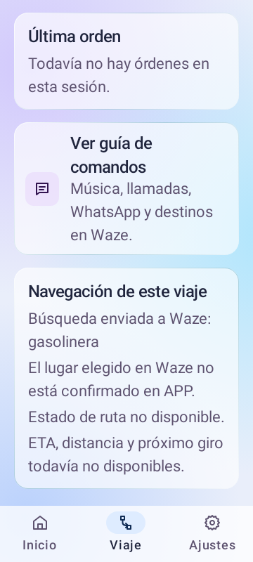

# Fase 2 · Contexto mínimo de navegación

## Base consolidada

Inicio: 13 de octubre de 2026. PR #13 integrado en RC1 mediante d82c017; PR #14 integrado en main mediante 506a604. La rama feature/fase-2-navigation-context parte de ese mismo commit. El usuario confirmó que la versión instalada cumple las funcionalidades esperadas hasta la fecha. Esta aceptación no sustituye un registro individual de casos, sesiones, casco ni identificador de APK.

## Primera entrega

Crear un contexto de navegación para la sesión actual de APP. Separar la solicitud a Waze del estado real de su ruta. Actualmente NavigationProvider permite favoritos y búsquedas, pero no ofrece lectura de contexto ni detención de navegación.

El contexto debe incluir proveedor, tipo de solicitud (favorito o búsqueda), destino o consulta y momento del despacho. El despacho se registra únicamente tras una apertura aceptada. Una búsqueda no confirma el lugar finalmente elegido en Waze. Cancelar una confirmación no registra una nueva solicitud enviada.

Conservar separado el último favorito persistente, utilizado por el comando de repetición, y el contexto temporal del viaje. Al terminar la sesión, invalidar el contexto temporal sin borrar ese favorito. Una sesión nueva no hereda una ruta activa de la anterior.

No afirmar «Navegando» tras abrir Waze. Presentar «Solicitud enviada a Waze» y «Estado de ruta no disponible». Reservar ETA, distancia y próximo giro para observaciones reales con origen y vigencia; ninguna estimación se presenta como lectura del navegador.

## Trazabilidad de implementación prevista

| Capacidad | Integración | Comprobación |
| --- | --- | --- |
| Contexto por sesión | Estado compartido del viaje y ciclo de vida del servicio | Detener/iniciar elimina solicitudes de la sesión anterior |
| Solicitud despachada | Caminos de apertura en ActionExecutor y TripVoiceService | Favorito y búsqueda se registran después del despacho; cancelación/fallo no registran envío |
| Presentación | Estado de UI y pantalla Viaje; reutilizar componentes glass | Solicitud visible y ruta desconocida explícita, sin activar escucha al dibujar |
| Coherencia de sesión | Burbuja y notificación conservan el estado de APP | Viaje activo no se interpreta como navegación activa |
| Repetición | NavigationRequestStore sigue conservando el último favorito | El contexto temporal no altera la compatibilidad de Casa/Trabajo/último |

Los comandos actuales, permisos y ajustes se mantienen en esta entrega. Las nuevas consultas habladas de ETA/giro requieren antes una fuente validada. El despacho conserva el feedback hablado existente y su recuperación de audio.

## Criterios de aceptación

1. Casa/Trabajo y búsqueda actualizan la solicitud de esta sesión sin certificar una ruta.
2. Cancelación o fallo de apertura no crean un despacho nuevo.
3. Detener el viaje y empezar otro elimina el contexto anterior; permanece el último favorito para repetición.
4. Ruta, ETA, distancia y giro ausentes no se rellenan con datos ficticios.
5. Pantalla, burbuja y notificación no contradicen el estado de sesión ni interfieren con Waze.
6. Compilación y pruebas pertinentes pasan; revisión visual y regresión física se declaran por separado.

## Siguiente hito

Comprobar una fuente real de contexto de Waze en el S22+ antes de habilitar lectura de ETA, distancia o giros. Después añadir consultas por voz. Otros navegadores y anuncios automáticos se evalúan en entregas posteriores.

## Implementación Contexto 1

Versión 1.1.0-f2-context1 (código 4). TripNavigationState conserva un contexto observable en memoria con identificador nuevo por sesión. Un despacho incluye proveedor, tipo, texto solicitado y fecha. ActionExecutor registra después de abrir desde Activity; el servicio registra la apertura directa en segundo plano y evita duplicar el registro delegado a Activity. Se rechazan registros identificados con una sesión anterior. El cierre del servicio limpia el contexto; la muerte del proceso no persiste una ruta activa.

Viaje muestra la tarjeta «Navegación de este viaje» durante la sesión. Reutiliza SectionCard y SupportingText. No añade permisos, comandos, ajustes ni capturas de voz; conserva feedback hablado y recuperación de audio. Burbuja y notificación conservan estados de APP, sin afirmar navegación real. El favorito persistente permanece al detener el viaje; una búsqueda no lo sustituye.

### Prueba física de esta entrega

Con la moto detenida, instalar la versión identificada y comenzar viaje. Confirmar Casa/Trabajo y revisar la tarjeta al regresar a APP; debe mostrar solicitud enviada y ruta no disponible. Buscar un lugar y comprobar que solo refleja la consulta, no el resultado elegido. Cancelar otra solicitud y comprobar que no reemplaza la anterior. Detener/iniciar y verificar tarjeta vacía, conservando el comando del último favorito. Repetir por botón y voz y comprobar recuperación musical, burbuja, bloqueo y texto grande. Estos resultados físicos quedan pendientes hasta ser reportados.

## Validación automatizada

El 13 de octubre de 2026 se completaron testDebugUnitTest, assembleDebug y lintDebug con JBR 21/Gradle 8.13: BUILD SUCCESSFUL. 205 casos: 204 aprobados, uno omitido, cero fallos y errores. Lint: cero errores, 109 advertencias y nueve sugerencias. Las cinco pruebas nuevas de contexto cubren aislamiento de sesiones, conservación del favorito, búsquedas, aperturas fallidas y solicitudes independientes de un viaje. La prueba nueva de Compose verifica el texto de la tarjeta y la renderiza con fuente al 150 % en Android JVM. No equivale a una captura del S22+ ni a validar Bluetooth.

APK debug generado y estructura ZIP verificada (manifiesto y classes.dex presentes). SHA-256: 28382EC029F05BCC651CEBA385FADA3DE415FD0BB16060F4D2C420117C33497E.

assembleFieldTest también terminó BUILD SUCCESSFUL. La copia de pruebas mantiene el identificador .pruebas y ahora se presenta como APP · Campo F2. Actualizar con la misma firma conserva sus datos y permisos; debug actualiza la instalación normal con su identificador previo.

La validación final se ejecutó en el clon original de Android Studio. Un intento previo de dirigir la salida a D desde C falló por raíces distintas; el siguiente intento en un clon de D se interrumpió por demora al escribir archivos generados. Ninguno se contabiliza como aprobado. No se sustituyeron dependencias ni se descartaron archivos locales. Release no fue revalidado en esta entrega.

## Aceptación e integración

El 13 de octubre de 2026 el usuario confirmó que los pasos propuestos funcionan y autorizó proseguir. Las dos capturas del teléfono muestran sesión activa en modo botón, solicitud a Casa y tarjeta «Navegación de este viaje» con ruta desconocida. No se inventan resultados individuales ni mediciones. PR #15 integrado en main mediante 7a0c239, conservando ascendencia.

Estado: Contexto 1 aceptado por el usuario e integrado. La siguiente entrega recoge evidencia de Waze: [Observación experimental](FASE_2_OBSERVACION_WAZE.md).

## Consulta hablada de la solicitud actual · NavQuery 1

En `feature/ui-storm-refined`, versión `1.1.0-f2-navquery1` (código 13),
«¿Qué destino pedí?», «¿Qué búsqueda hice?» y «¿A dónde voy?» consultan el
último despacho de APP en el viaje actual. La respuesta distingue una solicitud
de Casa/Trabajo de una búsqueda, nombra el proveedor que recibió el Intent y
aclara que APP no sabe si la ruta está activa ni qué resultado se eligió. Sin
viaje o sin despacho da una respuesta explícita. Cambiar el proveedor preferido
no reescribe la solicitud ya enviada; detener/reiniciar descarta el contexto.

No lee Maps ni Waze, no inicia navegación, no añade permisos y no altera las
direcciones opcionales de Maps. Comandos y Ajustes anuncian la frase disponible;
Viaje ya muestra la misma solicitud. Burbuja y notificación mantienen el estado
de sesión y la locución reutiliza la recuperación de audio existente.

Las suites `fullDebug` y `playstoreDebug` terminaron con 249 casos cada una,
cero fallos y dos y tres omisiones respectivamente. Las pruebas nuevas cubren
frases de consulta sin apertura, proveedor real del despacho, búsqueda y
aislamiento tras reiniciar el viaje. Es una comprobación en Android JVM.
`assembleFullDebug`, `assemblePlaystoreDebug`, `assemblePlaystoreRelease` y
`processPlaystoreReleaseManifest` terminaron correctamente. Los dos APK debug
firmados y el release sin firmar muestran versión 13; este último necesita la
firma de publicación antes de instalarse o subirse a Play.

Prueba física pendiente: con el casco, pedir Casa, consultar la solicitud y
confirmar que se nombra el proveedor correcto sin afirmar navegación activa.
Repetir tras una búsqueda, tras cambiar el proveedor y tras reiniciar el viaje;
comprobar que la música y el modo botón regresan normalmente.

## Contexto propio y consultas precisas · Context 2

En `feature/ui-storm-refined`, versión `1.1.0-f2-context2` (código 15),
la Fase 2 prioriza información que APP puede comprobar por sí misma. La lectura
de Waze/Maps sigue siendo experimental y optativa; no se añaden anuncios de
giros ni se depende de esa lectura para el estado general del viaje.

| Consulta o dato | Respuesta verificable | Límite explícito |
| --- | --- | --- |
| «Próximo giro» | Solo maniobra externa explícita y reciente | Nunca responde con la ETA si falta el giro; Waze ya anuncia sus propios giros |
| «Cuánto falta» | ETA observada y vigente de un proveedor; si falta, distancia a coordenadas del destino con GPS propio | La distancia se nombra «en línea recta» y nunca se presenta como duración o ruta vial |
| «Estado del viaje» | Duración de la sesión APP con origen propio, movimiento/velocidad de GPS reciente y preciso, tiempo en movimiento, música y batería disponibles | Una muestra vieja o de mala precisión no autoriza a afirmar velocidad o movimiento |
| Destino con coordenadas | Waze y Maps adjuntan el objetivo semántico al despacho de APP | No se deduce por cadenas del URI ni se asume que el navegador inició la ruta |
| Distancia recorrida del historial local | Solo suma pares en marcha, con velocidad y precisión suficientes y desplazamiento físicamente plausible | Descarta deriva estacionaria y saltos de GPS; no crea mapas ni rutas viales |

La distancia y el rumbo exigen un destino aún vigente. Si APP conserva las
coordenadas pero falta GPS reciente, la respuesta hablada distingue ese caso
de un destino no definido. La posición para contexto requiere permiso/ajuste activos, precisión horizontal
de 50 m o mejor y menos de 10 segundos de antigüedad monotónica; se rechazan
replays, muestras fuera de orden e inválidas. La voz exige mejor precisión
para velocidad y estado de movimiento. La grabación local conserva su recorte
de privacidad y retención, y no se inicia sin el consentimiento GPS existente.
No hay permisos, pantallas, burbuja ni notificación nuevos; cambia únicamente
el contenido de consultas ya disponibles. La prueba física de voz, GPS,
recuperación musical y exportación queda pendiente en el Samsung.

Queda para fases posteriores una ruta vial propia, geocodificación de
direcciones, lectura documentada del destino de apps externas, tráfico, POI y
conversación contextual. La [base de navegación propia](NAVEGACION_PROPIA_PLAN.md)
define cómo separar esa futura ruta de las observaciones externas. Sin esas
fuentes, APP declara el dato ausente.

### Verificación de Context 2

`testFullDebugUnitTest` y `testPlaystoreDebugUnitTest`: 264 casos cada uno,
cero fallos, dos y tres omitidos. Las pruebas incluyen contraste, navegación UI,
contexto propio y despachos con coordenadas en Maps/Waze. En la variante de
campo pasaron 19 pruebas dirigidas a contexto y proveedores; tras el último
ajuste de vigencia se repitieron las 14 de contexto. `assembleFullFieldTest` y
`assemblePlaystoreRelease` terminaron correctamente. `lintFullDebug` y
`lintPlaystoreDebug` habían terminado sin errores antes del ajuste final.
El APK de campo firmado tiene código 15, identificador `.pruebas` y SHA-256
`62d56d7d7d78b06c787718e453fbd049c36b3a84d727a0a598df9975062fa43b`.
La versión release de Play requiere la firma de publicación. No se verificó
renderizado ni comportamiento físico en teléfono o emulador de esta sesión.

### Ajuste posterior: navegador en segundo plano (15 de octubre)

La prueba del usuario confirmó que «cuánto falta» funciona con Maps al frente,
pero pierde el contexto cuando otra app queda al frente. Ahora, si APP observó
una ETA legible en la pantalla o en una notificación del mismo viaje, conserva
solo ese último número hasta dos minutos y responde con su antigüedad y la
advertencia de que no es una ETA actual. Una notificación reciente puede dar
un dato nuevo con el navegador en segundo plano. Si no hay ETA observada,
APP solo comunica la distancia en línea recta cuando conoce coordenadas del
destino y tiene un GPS preciso. El próximo giro requiere evidencia reciente;
no se conserva un giro antiguo para responder fuera del navegador.

Verificación posterior a integrar los cambios concurrentes de la misma rama:
268 pruebas por sabor, cero fallos (dos y tres omitidas); `assembleFullFieldTest`,
`lintFullDebug` y `lintPlaystoreDebug` terminaron correctamente. APK de campo
código 15, SHA-256 `A3990C90A8D0C5359B620DCEC1BEFB8B5ADDE49DB3F854906B406CBC9AFB954B`.
Queda pendiente probar la respuesta en el S22+ con Maps y Waze en segundo
plano; ninguna API usada garantiza una ETA continua en ese estado.

### Mi ruta con datos observados de Maps o Waze

La tarjeta compartida por Inicio → Mi ruta y Viaje ahora presenta los campos
recientes que APP realmente pudo observar del navegador: tiempo restante,
distancia restante, próximo giro y distancia a él, vía y aviso. Indica si la
fuente es Google Maps o Waze. Un aviso genérico de Waze («En ejecución. Toca
para abrir») no desplaza una notificación de Maps que sí contiene datos de
ruta. Cuando hay evidencia reciente de ambos, se elige el paquete de la
notificación de ruta publicada más recientemente; si un navegador está visible,
se usa únicamente ese paquete. Nunca se mezcla una ETA de Maps con un giro de
Waze. La solicitud enviada desde APP continúa separada de la lectura: ninguna
de las dos confirma por sí sola el destino elegido ni una ruta activa.

Los campos de giro y distancia vial solo aparecen mientras su observación es
reciente; al vencer desaparecen. Si no hay tiempo actual, la tarjeta puede
mostrar la última ETA observada del mismo proveedor durante dos minutos,
marcada con su edad y como dato que pudo cambiar. En la variante Full, Waze
puede aportar texto accesible de su pantalla mientras está al frente y datos
de notificación si los publica; con otra app al frente no se inventa un giro
desde iconos ni se conserva una maniobra antigua. Maps ya aportó físicamente
una ETA de 7 minutos por notificación; distancia, giro y otros campos quedan
condicionados a lo que publique en cada ruta y versión.

Se renderizaron las tarjetas de Maps y Waze con datos sintéticos en Android JVM
a fuente 150 %. Ambas suites debug aprobaron 270 casos por variante, cero
fallos, dos y tres omitidos. `assembleFullFieldTest`, `lintFullDebug` y
`lintPlaystoreDebug` terminaron sin errores. APK Full de campo, código 15,
SHA-256 `FC0902C35CF614838C92345C29BB9D442B560FF96E88A4CD8B36090A85126803`.
Falta comparar la tarjeta con notificaciones y pantalla reales del S22+ cuando
Maps y Waze están al frente y en segundo plano.

### Corrección de lectura y contexto propio · 15 de octubre

En la instalación `APP de pruebas` conectada del S22+ se comprobó que Android
concedía el acceso a notificaciones y que el modo desarrollador estaba activo,
pero faltaba la preferencia local de opt-in para observar avisos de navegación.
En Full ese interruptor inicia apagado; sin activarlo, APP no recibe datos de
Maps/Waze aunque el permiso de Android figure concedido. Mi ruta ahora explica
la falta de acceso y remite a Ajustes → Navegación. No se habilita el opt-in
automáticamente.

Además se corrigieron dos regresiones de la tarjeta: el reloj de refresco ya
no puede ser anterior a una muestra recién llegada, y una notificación de Waze
cuyo contenido de ruta venció no desplaza una ETA reciente de Maps. La copia
diagnóstica de avisos incluye por separado las muestras de ambos paquetes;
antes solo mostraba la última y podía ocultar la de Maps.

Cuando falta distancia vial, Mi ruta puede mostrar la duración de la sesión
propia de APP y, si hay un favorito con coordenadas y GPS preciso autorizado,
la distancia en línea recta claramente etiquetada. No se convierte en una
distancia de carretera ni en una ETA. La prueba física tras activar el opt-in
interno y comparar ambos navegadores continúa pendiente.

La verificación local de esta corrección terminó con 273 pruebas Full Debug
(cero fallos, dos omitidas) y 273 Playstore Debug (cero fallos, tres omitidas).
`assembleFullFieldTest`, `lintFullDebug` y `lintPlaystoreDebug` completaron sin
errores. El APK Full FieldTest generado tiene SHA-256
`691CECE3101D74DE8E4860471C5F9D44CB9A129327CCECBBE73D42D3F98BF9A6`.

Las capturas aportadas después muestran resultados distintos: con Waze en
segundo plano no aparece ningún campo de navegación; con Maps y una ruta
activa sí se observan 7 min, 2,7 km y llegada a las 12:14 desde
`GOOGLE_MAPS_NOTIFICATION`. La captura de Waze no incluye el texto bruto de
sus avisos, así que todavía no permite concluir si Waze publica una ETA que
APP omite. Una inspección adicional encontró que el lector reemplazaba todos
los avisos del mismo navegador por el último. Ahora conserva hasta ocho avisos
activos por paquete y selecciona solo contenido reciente con datos de ruta;
el reporte diagnóstico permite verlos por separado. Queda pendiente la prueba
en el S22+ con el opt-in interno activo y el APK actualizado.

Esta revisión completó 274 pruebas Full Debug (cero fallos, dos omitidas) y
274 Playstore Debug (cero fallos, tres omitidas). `assembleFullFieldTest`,
`lintFullDebug` y `lintPlaystoreDebug` completaron sin errores. SHA-256 del APK:
`473110D23847E42C7CED64F262444BAFC26AF96A6113CC004984BFBED2AB1622`.

### Base de rutas propias preparada · 15 de octubre

Se añadió un contrato de motor vial independiente de Maps/Waze y una selección
de destino propia, separada de los despachos a navegadores externos. La
solicitud del motor exige destino elegido en la sesión y GPS autorizado, real,
reciente y preciso. El resultado futuro tendrá geometría, maniobras y
procedencia con caducidad. El detalle y las alternativas gratuitas están en
`docs/NAVEGACION_PROPIA_PLAN.md`. Aún no hay motor ni control de selección de
destino: Inicio, Viaje, voz, burbuja y notificación conservan su comportamiento
actual y no anuncian ETA o giros calculados por APP.

Verificación: 277 pruebas Full Debug (cero fallos, dos omitidas) y 277
Playstore Debug (cero fallos, tres omitidas). `assembleFullFieldTest`,
`lintFullDebug` y `lintPlaystoreDebug` completaron sin errores. El APK de campo
compilado tiene SHA-256
`EC2AE6A86AA828B6D23F400CCC9C1627170765A1801EFE5A4000AD668436D222`.
No se probó una ruta propia en el S22+ porque todavía no hay motor conectado.

### Contexto 3 · complementar observaciones escasas

Versión `1.1.0-f2-context3` (código 16). El lector ahora une campos de varios
avisos **vigentes del mismo navegador**. Una notificación genérica no borra la
ETA o calle de otro aviso activo de ese proveedor; la selección del proveedor
continúa aislando Waze de Maps. Una notificación publicada hace demasiado
tiempo no se convierte en dato actual solo porque Android la entregó de nuevo
al reconectar el lector. Cada campo conserva origen y caducidad propios.
La distancia a un giro solo acompaña su instrucción si procede de la misma
observación, tanto en voz como en la tarjeta existente.

La geometría propia entre GPS autorizado y destino con coordenadas ahora es
un valor tipado `APP_STRAIGHT_LINE` con confianza, tiempo monotónico, caducidad
y rechazo de muestras simuladas. Conserva **distancia y rumbo en línea recta**;
no representa una carretera. Si la ETA del navegador solo es histórica, la
respuesta hablada puede dar ese dato con su antigüedad y añadir la distancia
lineal actual de APP, sin descontar minutos ni fabricar ETA. Esta geometría
queda disponible para el futuro seguidor de ruta propia.

No es posible deducir las coordenadas del destino de Waze a partir del aviso
«En ejecución», una calle o la posición del teléfono. Sin un destino explícito
en APP, no hay distancia restante propia. Sin mapa vial tampoco hay ETA,
maniobras o distancia por carretera propias. No se añadió permiso, sondeo
continuo, red ni lectura adicional de pantalla. Queda pendiente contrastar en
el S22+ varios avisos reales de Waze, la voz por botón y el comportamiento al
vencer o retirar avisos antes de declarar cerrada la Fase 2.

Las suites `fullDebug` y `playstoreDebug` ejecutaron 280 casos cada una,
sin fallos (dos y tres omitidos). Incluyen notificaciones múltiples de un
proveedor, aislamiento de Maps/Waze, rechazo de avisos publicados hace tiempo,
distancia propia simulada y asociación correcta de giro/distancia. La variante
`fullFieldTest` pasó 29 pruebas dirigidas a observación y contexto, sin fallos.
`lintFullDebug` y `lintPlaystoreDebug` terminaron sin errores; Play release
compiló sin la firma privada de publicación. El APK
`fullFieldTest` firmado conserva el identificador `.pruebas`, usa código 16 y
SHA-256 `3074d2cd889c9a9d54194a0e6ef05f3ca9f57a458229b6140334d4bf6a4f19a9`.
La prueba real en Samsung sigue pendiente; los fixtures Android JVM no prueban
qué texto publica Waze en una ruta concreta.

### Observador de ruta compacto · 16 de octubre

Versión `1.1.0-f2-observer1` (código 17), en `feature/ui-storm-refined`.
Ajustes → Navegación muestra un aviso basado en las pruebas de campo: Waze ha
expuesto pocos datos a APP y se recomienda Google Maps para contexto observado.
Waze continúa disponible para abrir destinos. No se generaliza la limitación a
todas las versiones de Waze ni se afirma que Maps confirme una ruta.

La burbuja ahora ofrece un **modo observador optativo**, separado de «Mostrar
sobre otras aplicaciones». Con viaje activo, permiso de superposición y
teléfono desbloqueado, un chip de 252 dp como máximo queda junto al borde si
APP tiene un giro, tiempo o distancia de Maps/Waze con menos de media vida de
su TTL de 15 segundos. El chip dice «observado» y muestra la fuente. Si falta
esa observación pero APP dispone de destino con coordenadas y GPS autorizado y
preciso, dice «APP · línea recta» con la distancia geométrica. Una notificación
genérica «Waze en ejecución» no produce chip. El conductor puede tocarlo para
abrir los controles, arrastrar la burbuja o apagar el modo en Ajustes. La
ventana conserva el mapa visible y solo ocupa su rectángulo acotado; no lee
píxeles ni interactúa con controles de otra app. La variante Playstore usa
avisos autorizados y la Full puede usar además el texto accesible con su
permiso específico de desarrollador.

La lectura para el chip reutiliza `routeCardSnapshot` cada dos segundos como
máximo mientras está visible, sin sondear batería o multimedia. Maps puede
aportar la hora de llegada **explícita** de una línea «Llegada: 12:14»; APP la
muestra con fuente en Viaje y en el chip. No calcula esa hora, no deduce
coordenadas de destino y no cambia la ETA de voz. La burbuja aún no detecta si
su posición tapa un control concreto del navegador: se coloca en el borde y
requiere comprobación y ajuste manual en el S22+ con Maps, Waze y letra grande.
No se añadió clima: falta elegir una fuente, política de actualización y
momentos de aviso que no distraigan.

Prueba pendiente en el S22+: actualizar APP · Campo F2 (paquete `.pruebas`),
habilitar burbuja, modo observador y acceso a avisos; iniciar viaje y fijar una
ruta real en Maps. Con Maps al frente y pantalla desbloqueada, comprobar la
fuente y el dato del chip, tocar para abrir controles y arrastrar hacia un
borde libre. Repetir con Waze; si solo aparece «En ejecución», el chip debe
volver a la burbuja sola. Comprobar letra del sistema al 200 %, giro del
teléfono, bloqueo, fin de viaje y que el mapa reciba toques fuera de la
pequeña ventana. Luego medir fluidez en el equipo físico. Con un destino
guardado por coordenadas y GPS preciso, verificar que el fallback indica
«línea recta» y desaparece al perder frescura. No realizar estas interacciones
con la moto en movimiento.

Verificación local: 285 tests Full Debug y 285 Playstore Debug, sin fallos
(dos y tres omisiones esperadas, respectivamente). Compilaron `fullFieldTest`
y `playstoreRelease`; `lintFullDebug` y `lintPlaystoreDebug` pasaron. Las
capturas Robolectric de la advertencia de Waze en
[claro](images/fase_2_waze_aviso_observador_claro.png) y
[oscuro](images/fase_2_waze_aviso_observador_oscuro.png), y del
[ajuste del observador al 200 %](images/fase_2_ajuste_observador_200.png)
se revisaron; el chip nativo sobre un navegador real no pudo verse en
este entorno sin dispositivo. APK Campo firmado con la misma clave de pruebas
anterior, código 17, SHA-256
`696bb341d424c3aa433127358b1893412662a2b4ba3c013c857920f43ecc1cf4`.

### Assistant1 · APP trabaja minimizada · 16 de octubre

Versión `1.1.0-f2-assistant1` (código 18) en `feature/ui-storm-refined`.
Durante el viaje, APP funciona como servicio y asistente sobre la aplicación
que el conductor tenga al frente. La burbuja visible **ya es su modo
observador**: el chip aparece automáticamente cuando APP recibe una lectura
reciente mediante permisos ya concedidos. Se retiró el segundo interruptor
«modo observador» de `observer1`. El control de burbuja y los permisos de
avisos y accesibilidad siguen siendo independientes. La burbuja no captura
píxeles, toca controles ajenos ni necesita que la ruta se haya abierto desde
APP; puede acompañar Maps, Waze o una app de reparto al frente. APP no observa
el contenido de esa app de reparto.

Antes de salir, Inicio → Mi ruta permite elegir **Casa** o **Trabajo** para el
próximo viaje si sus coordenadas están guardadas en APP. La elección se
consume una sola vez al iniciar el servicio: `TripNavigationContext` conserva
el destino y su momento de selección mientras dura la sesión, incluso con APP
minimizada. Viaje permite corregirlo con la moto detenida. Una solicitud a
Maps/Waze no crea una ruta propia de APP. Si la solicitud apunta a otro lugar,
APP invalida su destino anterior; una búsqueda no lo reemplaza. Al terminar
el viaje se limpia el
destino de sesión. La distancia lineal de GPS, la voz y la burbuja comparten
este destino; `RoadRouteEngine` puede usarlo cuando exista un adaptador vial.

APP **no puede importar automáticamente** el destino ni la geometría de una
ruta elegida dentro de Maps/Waze mediante sus APIs públicas actuales. Sus
avisos observados aportan giros, ETA y distancias solo cuando los publican y
durante su vigencia. El destino fijado en APP tampoco confirma que Maps/Waze
naveguen hacia él. Para clima a lo largo de una ruta harán falta un trazado
propio fiable o una fuente autorizada que lo comparta, además de pronóstico y
reglas de aviso de inicio, mitad y final; no se generan todavía avisos
meteorológicos espontáneos.

Prueba física propuesta con la moto detenida: guardar coordenadas de Casa,
fijar Casa en Inicio → Mi ruta, iniciar viaje y poner Maps al frente. La
burbuja debe mostrar automáticamente los datos recientes disponibles y la
voz debe poder usar la distancia lineal de APP cuando no haya ETA externa.
Volver a APP debe mostrar «Destino fijado en APP: Casa»; al detener y comenzar
otro viaje, esa elección ya no debe quedar activa. Repetir con Waze y observar
que un aviso genérico no se convierte en ETA ni maniobra. Probar además la
burbuja sobre una app de reparto: APP permanece disponible, sin leer esa app.

Verificación local: 292 tests Full Debug y 292 Playstore Debug, sin fallos
(dos y tres omisiones esperadas, respectivamente). Compilaron `fullFieldTest`
y `playstoreRelease`; `lintFullDebug` y `lintPlaystoreDebug` pasaron. Capturas
Robolectric revisadas: [destino en oscuro](images/fase_2_destino_app_proximo_viaje.png),
[destino con fuente al 200 %](images/fase_2_destino_app_200.png) y
[aviso de burbuja en claro al 200 %](images/fase_2_burbuja_observador_200.png).
Sin dispositivo conectado no se pudo comprobar el chip nativo encima de Maps,
Waze o una app de reparto, ni la fluidez del equipo. APK Campo código 18,
firmado con la misma clave de pruebas anterior; SHA-256
`383ed63a7455d162fdb63f876b3adc27ed04ac157c7de7cd518ab319cfeb3871`.
