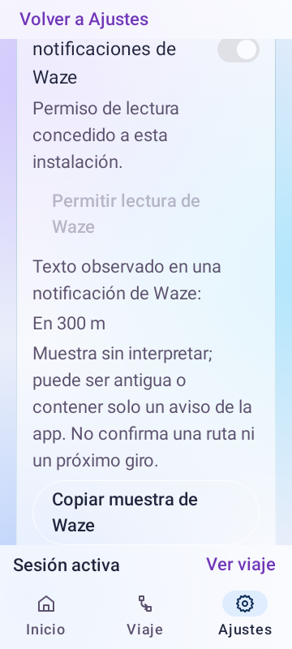

# Fase 2 · Observación experimental de Waze

## Objetivo y base

Rama feature/fase-2-waze-observation desde main 7a0c239, después de aceptar e integrar Contexto 1. Versión 1.1.0-f2-observation1, código 5. Esta entrega comprueba qué textos ofrece realmente Waze antes de habilitar NEXT_TURN/CURRENT_ETA. No interpreta una solicitud enviada o una notificación genérica como ruta activa.

## Investigación al 13 de octubre de 2026

Los [Deep Links de Waze](https://developers.google.com/waze/deeplinks) permiten abrir destinos y búsquedas; no ofrecen retorno de giro/distancia/ETA. La comparación oficial del [Transport SDK](https://developers.google.com/waze/intro-transport) describe esos datos en el SDK para socios, pero anuncia fin de soporte el 1 de noviembre de 2026. No se incorpora ese SDK.

La nueva [Navigation Connect API](https://developers.google.com/maps/documentation/navigation/connect/overview) ofrece ubicación, ETA, distancia restante y estado del viaje con backend, tokens y consentimiento del conductor. No es el retorno local de los enlaces actuales de APP ni una fuente de próximo giro documentada en esa descripción. Se conserva como alternativa futura; esta entrega no configura cuentas, cobros ni servicios externos.

[NotificationListenerService](https://developer.android.com/reference/android/service/notification/NotificationListenerService) permite observar las notificaciones con permiso del usuario. Android documenta campos estándar de texto en [Notification](https://developer.android.com/reference/android/app/Notification), pero no garantiza qué texto publicará Waze ni que incluya datos de navegación. La hipótesis de que sirva para giro/distancia se debe comprobar en el S22+; no se da por confirmada. AccessibilityService permanece como posible fuente aislada si la evidencia muestra que las notificaciones son insuficientes.

## Implementación

- Servicio independiente WazeNavigationObservationService con permiso específico de esta instalación; no cambia TripMediaAccessService ni su acceso a sesiones musicales.
- Lectura desactivada por defecto. Requiere BuildConfig.DEBUG, opt-in de desarrollo, interruptor propio, permiso concedido y sesión de APP activa. Release no permite iniciar el experimento.
- Filtra com.waze antes de acceder al contenido. Solo retiene una muestra textual acotada: título, texto, texto ampliado, subtítulo (240 caracteres cada uno) y hasta cuatro líneas (240 cada una), categoría y fechas de publicación/observación. No retiene Notification/RemoteViews, imágenes, acciones ni contenido de otras apps.
- Conserva la muestra en memoria. Cierre/reinicio de viaje, desconexión, retirada de la notificación, revocación o desactivación limpian la muestra. Un identificador anterior no puede actualizar una sesión nueva. No envía ni guarda automáticamente los textos.
- La antigüedad se calcula desde publicación, no desde la apertura de APP. El informe distingue muestras recientes (hasta 60 s), antiguas o con fecha futura. Esta clasificación es diagnóstica, no certifica vigencia de una ruta.
- Ajustes → Navegación muestra controles y muestra únicamente con desarrollo activo. El usuario copia el informe de forma explícita. Viaje, burbuja, notificación, comandos y voz conservan el comportamiento aceptado; ETA/giro siguen no disponibles hasta comprobar y adaptar la fuente real.

## Trazabilidad

| Capacidad | UI | Prueba |
| --- | --- | --- |
| Consentimiento y permiso propios | Desarrollo activo → Ajustes → Navegación | Desactivado, falta de permiso, permiso multimedia sin permiso Waze, release de consulta |
| Lectura pasiva filtrada | Muestra experimental | Otros paquetes ignorados; límites de texto y campos desconocidos |
| Aislamiento de sesión | Muestra e informe | Cierre/reinicio, callback viejo, retirada, desconexión y opt-out |
| Evidencia temporal | Copiar muestra | Fecha de publicación conservada; abrir APP no rejuvenece datos |
| Coherencia | Viaje mantiene ruta desconocida | La muestra no activa micrófono, navegación ni TTS |

## Prueba en teléfono para cerrar esta entrega

1. Instalar debug o fieldTest de esta versión conservando la misma instalación. Con la moto detenida, Ajustes → Acerca de APP: siete pulsaciones sobre la versión y confirmar acceso de desarrollo.
2. Ajustes → Navegación: activar «Observar notificaciones de Waze» y «Permitir lectura de Waze». En Android conceder acceso al servicio «APP · lectura experimental de Waze» de la instalación que se está probando. El permiso multimedia anterior no lo sustituye.
3. Iniciar viaje de APP y una ruta real en Waze. Regresar a Ajustes → Navegación sin detener el viaje. Copiar la muestra de Waze y comparar con la notificación visible. No se necesita circular para recoger la primera muestra.
4. Recoger una muestra con ruta activa y otra con Waze sin ruta, si publica un aviso; comparar los campos. Verificar retirada, desconexión/reinicio y que detener APP borre la muestra.
5. Revisar música/botón y comprobar que no se anuncian giros. Si Android no entrega texto o solo ofrece un aviso genérico, registrar esa limitación antes de elegir otro origen.

La muestra puede contener destinos o calles de Waze: revisar el texto antes de compartir el informe. No se necesitan datos de otras notificaciones.

## Estado

testDebugUnitTest, assembleDebug, assembleFieldTest y lintDebug terminaron BUILD SUCCESSFUL. 213 casos: 212 aprobados, uno omitido, cero fallos y errores. Lint: cero errores, 110 advertencias y nueve sugerencias. Las seis pruebas nuevas de origen verifican filtrado, límites, tiempo, permiso propio, gates, aislamiento, retirada y revocación. Dos pruebas nuevas de Compose comprueban el ocultamiento sin desarrollo y la copia explícita de una muestra.

La ejecución dirigida de testReleaseUnitTest con WazeNotificationObservationTest también pasó: seis casos, sin omisiones, fallos ni errores. Confirma que el gate de BuildConfig.DEBUG bloquea el lector incluso con preferencias/permiso configurados. No se declara una regresión completa de release.

La captura muestra datos sintéticos de prueba; se inspeccionó texto, scroll y copia. No es una captura real de Waze. Ambos APK contienen manifiesto y classes.dex. SHA-256 debug: 1841A6D097DA795F97E34FD7675A2DF483B7CB86F33E893FD40964CAD512C9E3. SHA-256 fieldTest: 9389A8CDA5CA53472923BFC94752D145FF3BB71C65E990EB71BA926427D1C757.

Implementación y validación automatizada completadas. No hay teléfono conectado en esta ejecución; la fuente y el contenido reales de Waze quedan pendientes de la prueba anterior. Los ejemplos sintéticos de las pruebas JVM no se presentan como evidencia del navegador.
