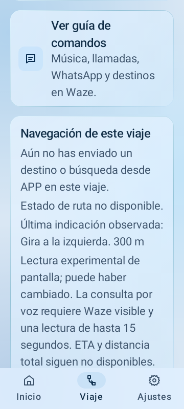

# Fase 2: pantalla de Waze y consulta de próximo giro

## Base y evidencia

La rama feature/fase-2-waze-screen parte de feature/ui-storm-glass b862acf, que incluye la observación de notificaciones f106724. Se conserva el diseño azul tormenta y el carrusel vigente; no se integra ni elimina una rama de UI sin su validación. El usuario reportó ruta iniciada y avisos hablados de giro en Waze, pero la notificación observada contenía únicamente «Waze / En ejecución. Toca para abrir». Es evidencia de esa muestra, no de que todas las versiones o estados de Waze sean iguales.

Versión 1.1.0-f2-screen1, código 6. La entrega incorpora un lector de pantalla independiente y una consulta por voz. Sigue siendo experimental hasta probar qué contenido accesible expone Waze en el S22+.

Actualización Screen 2: versión 1.1.0-f2-screen2, código 7, sobre la misma rama por instrucción del usuario. La burbuja visible evita apagado por inactividad mediante la bandera de su ventana; al regresar a APP conserva esa protección si está habilitada y no oculta. Ocultar/desactivar o detener libera la protección de la burbuja. Se conserva el bloqueo físico voluntario. Detalle y prueba de temporizador: [UI azul tormenta](UI_AZUL_TORMENTA.md). assembleDebug y assembleFieldTest terminaron BUILD SUCCESSFUL; la prueba de tiempo de apagado en S22+ queda pendiente. No se atribuye a Screen 2 una reejecución de las pruebas de Screen 1.

## Lectura pasiva y límites

Servicio de [Accesibilidad](https://developer.android.com/reference/android/accessibilityservice/AccessibilityService) con canRetrieveWindowContent y eventos restringidos a com.waze. Permiso propio, desactivado por defecto, con BuildConfig.DEBUG, desarrollo activo, opt-in específico y sesión de APP. Release no habilita el lector. No ejecuta gestos, clicks, acciones de nodos ni capturas de imagen, y no cambia la app al frente.

Consulta la ventana activa en un trabajador cada dos segundos; verifica su paquete antes de leer contenido. Desde `1.1.0-f2-navquery2` recoge texto/descripciones visibles de toda la ventana de Waze o Maps, porque en la prueba real la tarjeta de maniobra quedó fuera del recorte anterior del 40 %, especialmente con ventana dividida. Mantiene el límite de 200 nodos, profundidad 12, 64 textos de 180 caracteres y solo los paquetes de ambos navegadores. La pantalla bloqueada y la falta de permiso descartan datos. Cierre/reinicio, desconexión y opt-out invalidan muestras; una devolución de la sesión anterior no puede reemplazar el nuevo estado. No se conserva el árbol de vistas ni hay guardado/envío automático.

El parser exige una sola indicación explícita de maniobra. No transforma nombres de calles o avisos genéricos en giros. Adjunta una distancia únicamente si es un texto de unidad completo, único y cercano (180 píxeles); no extrae la distancia total o ETA. Las unidades decimales se conservan. Ese criterio deberá ajustarse con evidencia de la pantalla real; un icono sin descripción accesible puede no ofrecer una maniobra reconocible.

## Consulta y UI

NavigationProvider expone nextTurnAnswer a ActionExecutor; el servicio de voz no interpreta detalles de Waze. «¿Cuál es el próximo giro?», «¿Qué indica Waze?» y «next turn» son consultas deterministas, sin abrir otra app. La respuesta identifica la pantalla de Waze y solo usa un giro reconocido, ventana visible y una lectura de hasta 15 segundos. En ausencia de datos, permiso o modelo fiable, APP explica que no tiene una indicación reciente. No hay anuncios automáticos.

Se reutiliza la locución y recuperación de audio existente, con cancelación y generación de sesión. Comandos incluye la guía de esta consulta. Viaje presenta una última indicación observada, marcada como experimental y potencialmente cambiada, sin certificar ruta activa. ETA y distancia total continúan sin datos. Burbuja/notificación conservan las acciones y estado de APP; no dibujan ni anuncian datos ficticios.

Con desarrollo activo, Ajustes → Navegación incorpora opt-in, acceso a Accesibilidad y copia explícita de la muestra de pantalla. Los controles se bloquean durante un viaje; la copia es de consulta y no activa audio. La notificación anterior permanece como fuente diagnóstica separada.

## Prueba física

1. Instalar esta rama conservando la variante anterior. Sincronizar Android Studio por el cambio de versión.
2. Con viaje detenido y desarrollo activo: Ajustes → Navegación → Observar pantalla de Waze → Configurar Accesibilidad para Waze. En servicios/apps instaladas activar APP · lectura de pantalla de Waze de esta instalación. Si Android bloquea la habilitación por instalación externa, seguir las opciones de configuración restringida que muestre Android para esta app.
3. Iniciar viaje APP y una ruta Waze; dejar Waze al frente con la próxima indicación visible y teléfono desbloqueado. Esperar la lectura y pedir «¿Cuál es el próximo giro?» desde casco/botón. Comparar respuesta con pantalla real y verificar recuperación de música.
4. Cancelar una consulta, probar silencio desde notificación, detener/reiniciar, revocar permiso, bloquear y poner otra app al frente. No debe reutilizar una indicación vieja como actual ni terminar el viaje por ausencia de lectura.
5. Regresar a Ajustes → Navegación sin detener el viaje y copiar la lectura de pantalla. Incluye posiciones y texto acotados para adaptar los nodos reales si Waze no proporciona una maniobra reconocida. Al regresar a APP, la ventana deja de ser Waze: la muestra permanece solo para diagnóstico, la consulta pierde disponibilidad.

El informe de pantalla ahora se puede copiar aunque no haya textos accesibles. Incluye el estado del interruptor, permiso, desarrollo y viaje, para distinguir falta de acceso de una pantalla de Waze sin nodos útiles. Se distingue por el encabezado «Fuente: pantalla de com.waze» y el botón «Copiar estado de pantalla de Waze». El botón de la tarjeta siguiente copia la notificación.

Evidencia inicial del usuario: Samsung SM-S906U, Android 16, informe de notificación fechado 2026-10-13T23:26:20Z. El lector estaba conectado, sin fallo de lectura y con sesión activa; la muestra era reciente y contenía `android.title: Waze` y `android.text: En ejecución. Toca para abrir.` El usuario oyó que el giro no estaba disponible y volvió a copiar la misma muestra. Esa evidencia solo confirmaba el contenido de la notificación; el informe de pantalla se obtuvo el 15 de octubre y se describe abajo.

La lectura de Accesibilidad depende de la interfaz de Waze y no sustituye su API. La muestra física de pantalla se recogió el 15 de octubre; faltan la comparación de voz con Waze y la recuperación de audio. Los ejemplos de JVM son sintéticos.

## Prueba real y ajuste de campo · 15 de octubre de 2026

El Samsung SM-S906U con Android 16 confirmó permiso, lectura activada, servicio conectado y sesión activa. El informe de pantalla de Waze conservó cinco textos accesibles, entre ellos «Sigue la ruta destacada», pero ningún giro explícito; `visible=false` era esperable después de volver a APP para copiarlo. La captura simultánea mostraba más abajo una tarjeta de maniobra con distancia y calle, junto a un icono direccional. El recorte superior del 40 % no llegaba a ella. Waze también avisaba que no tenía señal GPS y mostraba ubicación aproximada; no se afirma ruta confirmada.

`navquery2` amplía la lectura a la ventana visible del navegador y exige una indicación direccional explícita antes de llenar «Giro». «Sigue la ruta destacada» ya no es un giro; una distancia suelta junto a un icono tampoco se clasifica como distancia restante al destino. Si la pantalla advierte pérdida de GPS, una duración mostrada en la vista previa no se anuncia como ETA vigente. La carretera puede figurar como texto observado si Accesibilidad la expone. La dirección dibujada solo en un icono permanece desconocida: no se usa OCR ni se infiere un giro por la forma. Falta una nueva muestra real con Waze al frente para saber si los nodos de la tarjeta inferior exponen distancia, calle y ETA, y la comparación de la respuesta por voz con Waze.

Cuando ambos navegadores publican notificaciones, se elige una sola muestra reciente. Si la pantalla de Waze o Maps está visible, únicamente se combina con la notificación de ese mismo paquete; una ETA de Maps no acompaña un giro observado en Waze.

## Validación

Suite completa debug: 228 casos, 227 aprobados y uno omitido, cero fallos y errores. assembleDebug y assembleFieldTest completados; lintDebug sin errores, 112 advertencias y nueve sugerencias. Las cinco pruebas de contexto cubren parsing conservador/distancia, consultas deterministas, lecturas vencidas/ocultas, separación de sesiones y gates. Las dos nuevas de Compose comprueban que el opt-in no abre micrófono y que la lectura se muestra como observación en el material azul tormenta.

Después del ajuste del gate de bloqueo se repitió la suite debug completa y se regeneraron ambos APK. La comprobación de release se detuvo inicialmente por un método mal nombrado del fixture de Keyguard de Robolectric; se corrigió el fixture y las cinco pruebas dirigidas de WazeScreenContextTest pasaron tanto en debug como release, sin omisiones, fallos ni errores. No se presenta ese intento interrumpido como aprobado ni se declara una regresión completa de release.

Se inspeccionó la tarjeta renderizada con desplazamiento y texto grande. Es un ejemplo sintético; no prueba que Waze exponga ese texto en el teléfono. Ambos APK contienen manifiesto, classes.dex y la configuración del servicio de Accesibilidad. SHA-256 debug: 114102D32B5C5A2500265611151343EB282D0FCF8A3F5482E83688D104062095. SHA-256 fieldTest: 2D6C902576A8BE4A911C7698566EF7B2E5916F42BA6FCCA714036B68E01E73AC.

Ese ciclo inicial no tenía teléfono conectado. Tras la muestra del 15 de octubre, quedan pendientes los nodos de la tarjeta inferior, la audibilidad, la recuperación musical y la comparación en modo voz/botón. Mantener en borrador.

### Validación de `navquery2`

La suite completa de `fullDebug` pasó (259 casos, dos omitidos); la de `playstoreDebug` también (259 casos, tres omitidos). Las 15 pruebas dirigidas de `TripContextTest` y `WazeScreenContextTest` pasaron en `fullFieldTest`, y se compilaron los APK de campo y Play debug. La suite completa `fullFieldTest` aún falla en 29 casos: 28 pruebas de interfaz usan un host `ComponentActivity` no registrado para el sufijo `.pruebas`, y una prueba de permiso multimedia presupone el paquete sin sufijo. Son limitaciones del fixture de esa variante, no se cuentan como pruebas aprobadas. No hay emulador o Samsung conectado en esta ejecución para comprobar el resultado renderizado ni el nuevo texto de Waze.
