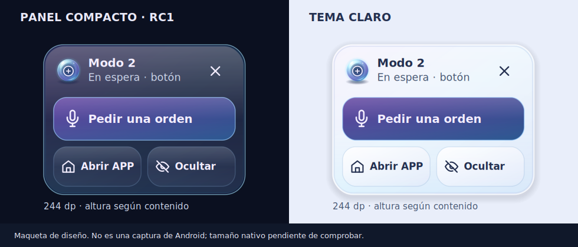
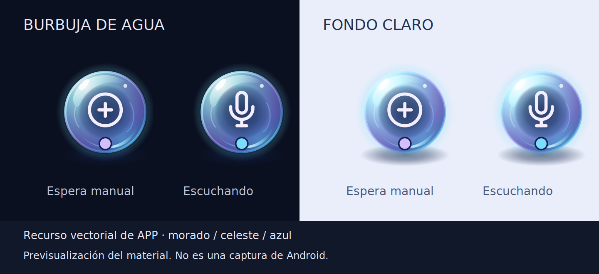

# UI de APP Copiloto Moto · Fase 1

## Fase 2 · Contexto de navegación · 13 de octubre de 2026

La base consolidada está en main (506a604); el trabajo continúa en feature/fase-2-navigation-context. Viaje incorpora una tarjeta glass «Navegación de este viaje», observando el contexto de sesión compartido: favorito o búsqueda despachados a Waze, ruta desconocida y ausencia de ETA/distancia/giro. Una búsqueda no confirma el resultado elegido en Waze. No se inicia escucha desde la tarjeta ni se añaden controles o permisos. Burbuja y notificación mantienen su estado de sesión de APP; no muestran una ruta activa ni datos de Waze. Alcance y prueba: [Fase 2](FASE_2_NAVEGACION_CONTEXTO.md).

## Ajustes de usuario y desarrollo · 13 de octubre de 2026

La entrega activa de Ajustes está en `feature/settings-user-developer`, derivada de `release/fase-1-rc1` (`c2415f3`), que ya contiene la UI glass y la burbuja compacta. Consulta [estructura, límites y protocolo de prueba](AJUSTES_USUARIO_DESARROLLO.md). Los diagnósticos técnicos dejan de estar en el recorrido normal; se conserva el runtime de voz, música, navegación, llamadas y mensajería.

## RC1 · Burbuja compacta 02 · 13 de octubre de 2026

Por indicación del usuario, `release/fase-1-rc1` es ahora la rama de trabajo de esta entrega. Se integra toda la UI vigente de `feature/ui-glass-redesign` en `1d58c29` sobre RC1 `88d4ed1`. Ambas parten de `4e99900`: se conserva el reconocimiento bilingüe, los ajustes de idiomas, tonos, cancelaciones, pruebas y versión de RC1; se incorpora la esfera de agua y sus recursos. Las dos modificaciones comunes de `ui_strings.xml` y `UI_BASE.md` se combinaron conservando los textos funcionales y documentación de ambas. Identificador visible: **Fase 1 · RC1 · Burbuja compacta 02**.

### Panel abierto

- El ancho habitual baja de 280 a 244 dp. La altura fija de 344 dp se sustituye por la medición natural del contenido: encabezado, acción principal y accesos. No hay espacio vacío reservado ni expansión a pantalla completa.
- El encabezado reúne esfera con icono de estado, modo y estado real breve. El lector de pantalla conserva el estado completo, incluida la espera con micrófono cerrado. La acción principal es «Pedir una orden»; Abrir APP y Ocultar comparten una fila con objetivos táctiles de 48 dp o más.
- El material tiene borde exterior luminoso, un segundo borde interior, reflejo superior y botones con relieve suave. Los textos mantienen color opaco y los fondos tienen tinte suficiente para reducir el ruido visual de la app de atrás. No se captura ni se desenfoca la pantalla de otras apps.
- Con fuente al 130 % o más, o menos de 224 dp útiles para la tarjeta, los accesos pasan a vertical. La altura se limita al espacio útil; Pedir una orden y Abrir APP se pueden desplazar y Ocultar permanece fuera del scroll. Se reconstruye la presentación cuando cambia la configuración, sin cambiar la sesión.
- Se conservan arrastre/anclaje, ×, toque fuera, ocultar durante el viaje y permiso opcional. Solo Pedir una orden solicita la captura existente; disponibilidad, llamada y recuperación siguen observándose desde RC1.



La imagen es una **maqueta de diseño**, generada por `tools/render_compact_overlay_preview.py`; reutiliza los vectores de producción y los textos de recursos. No es una captura nativa ni prueba el tamaño medido, tipografía, contraste sobre Waze, ripple, acceso táctil o scroll de Android. El recurso de la esfera también conserva su [previsualización](images/burbuja_agua_vector.png).

### Dirección futura del overlay

La preferencia solicitada para el modo completo queda registrada: clima en la esquina superior derecha y módulos transparentes sobre navegación, WhatsApp y otras apps de conducción, adaptados a tamaño, orientación y áreas seguras. Es una dirección futura, vinculada a RF-137 y al contexto de viaje; requiere datos reales del clima, disponibilidad de cada módulo y elección de qué mostrar sin tapar controles externos. Esta entrega implementa únicamente el panel compacto; no presenta clima ni módulos ficticios como activos.

### Validación de esta integración

`assembleDebug`, `assembleFieldTest`, `testDebugUnitTest` y `lintDebug` completaron correctamente con la dependencia real `openwakeword-android:0.1.2`: 143 pruebas JVM, cero fallos/errores/saltadas, y lint con cero errores, 74 advertencias y 9 sugerencias. Los cinco casos nuevos cubren ancho, densidad, límite de altura en paisaje, ventana estrecha y fuente grande. Los recursos XML, la integridad ZIP de ambos APK y `git diff --check` también pasaron. La medición de vistas, superposición, gestos y audio deben comprobarse en S22+ / Y12 Pro mediante R19–R22 de [la regresión RC1](REGRESION_FASE_1_RC1.md). Registrar capturas nativas con la misma fuente, tema, modo y estado; los casos físicos permanecen sin resultado en el CSV hasta ejecutarlos.

## Burbuja de agua 01 · 13 de octubre de 2026

Sobre `feature/ui-glass-redesign` en `4e99900`, el acceso flotante pasa de una cápsula plana con texto a una esfera vectorial de agua de 64 dp, con sombra de contacto, reflejo superior, borde celeste/morado y pictograma de estado. `overlay_water_orb.xml` contiene el material estático; `OverlayGlassStyle` comparte el acabado del panel y los botones nativos. No se agregan dependencias de Android, capturas de pantalla, blur del mapa ni animación decorativa continua. Los iconos y el indicador solo cambian cuando cambia el estado observado.

El panel tiene tinte de vidrio, soporte contrastado para el estado, botones de 52 dp con iconos y feedback de toque. × minimiza; tocar fuera también minimiza; Ocultar burbuja permanece fuera del scroll y conserva su significado. Mostrar, tocar para desplegar, arrastrar, minimizar y ocultar no piden una orden. Solo el botón Pedir una orden llama al callback existente y conserva su bloqueo por disponibilidad y llamada. El anclaje lateral y la preferencia opcional se conservan.

### Evidencia visual



La imagen se generó desde el VectorDrawable XML de producción mediante `tools/render_overlay_vector_preview.py` (CairoSVG). Es una previsualización del recurso y sus pictogramas, no una captura de Android ni de Waze; permite evaluar sombras, gradientes y reflejos en dos fondos. No demuestra todavía el layout del panel, ripple nativo, arrastre, texto ampliado ni superposición en un teléfono. El acabado es vidrio pintado sin desenfoque de las apps externas.

### Comprobación en S22+ / Y12 Pro

- Con viaje activo, mostrarla sobre Waze en claro y oscuro. Revisar tamaño, contraste, posición de reflejos y que no tape indicaciones.
- Tocar la esfera: abre el panel y no abre micrófono. Arrastrar y soltar en cada borde, minimizar con × y tocando fuera, reabrir y ocultar. El audio y el viaje deben continuar.
- En modo botón, comparar espera (botón, micrófono cerrado), escucha (micrófono), procesamiento (reloj), respuesta (altavoz), confirmación (?) y llamada (teléfono) con el estado anunciado por APP.
- Pedir una orden: verificar señal, respuesta y recuperación de música. Durante preparación, llamada o falta de disponibilidad, el botón conserva su bloqueo.
- Con texto al 150–200 % y en paisaje, comprobar que Ocultar sigue visible y que el resto de acciones se pueden desplazar.

La validación final completó `:app:assembleDebug`, `:app:assembleFieldTest`, `:app:testDebugUnitTest` (124 pruebas, cero fallos, errores o saltadas) y `:app:lintDebug` (cero errores, 76 advertencias y 9 sugerencias). Se compiló con `com.github.msnilsen:openwakeword-android:0.1.2` real, sin sustituirla por una interfaz temporal. Los XML y `git diff --check` también pasaron. Esto verifica recursos, compilación y regresiones JVM; la comprobación física del audio, tacto, legibilidad y las capturas reales del panel sobre Waze siguen pendientes.


## Refinamiento de vidrio · versión 1.2 · 13 de octubre de 2026

La rama `feature/ui-glass-redesign` continúa la entrega vigente sin tocar los flujos de voz, llamadas, música, navegación ni borradores. El material visual se centraliza en `presentation/theme/Glass.kt`: `GlassPanel` aplica tinte, borde con reflejo y elevación a Inicio, Viaje y Ajustes. Los paneles normales usan blanco al 64 % en claro y azul noche al 39 % en oscuro; el principal usa 76 % y 51 %. El fondo estático morado, celeste y azul se distingue a través del material. El reflejo del borde y la sombra dan profundidad sin reducir la opacidad de textos e iconos.

El color del contenido se fija según el tema (`onSurface` dentro de vidrio y `onBackground` en el cuerpo), ya que el color translúcido personalizado no resuelve automáticamente el color de contenido en Material 3. `glassTextFieldColors` fija texto, etiqueta, placeholder, cursor y bordes de las entradas. Los botones principales usan el par `primary/onPrimary`; los claros y los menús conservan su contraste propio. `ActionButton` admite icono vectorial, disponible/deshabilitado y respuesta táctil de Material. `ChoiceGroup` distingue la fila elegida mediante borde, tinte y radio, además del texto. El botón de sesión cambia entre iniciar, detener y abrir Viaje de acuerdo con el estado real; el modo botón usa icono propio en vez del micrófono. Este sistema se usa también en las rutas auxiliares para mantener coherencia.

No se añade desenfoque real: el fondo ya consiste en gradientes de escala grande y Compose `Modifier.blur` desenfocaría el panel y sus controles, sin aislar la capa posterior en Android 26. La transparencia más visible y las capas de color conservan la legibilidad y evitan coste de captura o procesamiento adicional durante el audio. Los previews de `CopilotApp.kt` cubren Inicio, Viaje y Ajustes en claro/oscuro y texto al 150 %, pero solo una ejecución con renderizador permite inspeccionar el resultado. Si se dispone de emulador o dispositivo, guardar capturas antes y después con misma pantalla, tema, tamaño de fuente y estado de sesión; revisar especialmente contraste, transmisión del fondo, estados pulsado/deshabilitado y alineación.

La comprobación local de la versión 1.2 completó `assembleDebug`, `testDebugUnitTest` (124 pruebas, sin fallos) y `lintDebug` (cero errores, 70 advertencias y 9 sugerencias). Se usó una interfaz temporal local para `openwakeword-android` fuera del repositorio porque JitPack no es accesible en este entorno; el APK de esa comprobación no sirve para validar la detección de voz. Solo hay `adb`, sin emulador, acceso a un dispositivo o motor de previews, por lo que no se pudieron exportar capturas reales antes/después. La compilación con la dependencia real, inspección de previews y pruebas del S22+ con Y12 Pro siguen pendientes.

## Rediseño de vidrio · 12 de octubre de 2026

Base comprobada: `feature/fase-1-intent-router` en `1c826ff72b686e23760e089b3556b06669456467`. `main` permanece en `c8d80c7` y no contiene el núcleo actual. La entrega vive en `feature/ui-glass-redesign`, derivada de fase 1. Las reglas de evolución se guardan en el `AGENTS.md` raíz.

La navegación principal conserva Inicio, Viaje y Ajustes. Comandos y Pruebas permanecen como rutas secundarias; Ajustes ya tenía siete subpantallas y conserva sus controles. Inicio prioriza el estado y la acción de viaje, resume el casco y deja los módulos futuros colapsados. Viaje deja la orden pendiente y el último resultado sobre audio y métricas desplegables. Ajustes muestra algunos valores observados en sus filas. Cambiar pantallas no inicia ni detiene el servicio.

### Sistema visual aplicado

| Elemento | Implementación |
| --- | --- |
| Fondo | `CopilotBackdrop`: azul noche `#0B1020` o claro `#E9EEFA`, con tres gradientes radiales morado, celeste y azul, estáticos. |
| Material | `GlassPanel`: tinte blanco al 64 % en claro y azul al 39 % en oscuro; panel principal al 76 %/51 %. Borde con reflejo de 1 dp y sombra moderada. |
| Acentos | Morado `#B69CFF`, celeste `#6DDCFF`, azul `#82AFFF` en tema oscuro; variantes de mayor contraste en claro. |
| Forma y espacios | Radios Material 3 de 12/20/28 dp y espacios de 8/12/16/24 dp. Botones y filas mantienen al menos 48 dp de alto. |
| Iconos | Vectores de trazo de 2 dp para navegación, categorías y acciones principales; etiquetas de texto acompañan cada acción. |
| Estado | `MainActivity.AppUi` adapta `TripTestState` y lecturas pasivas a `CopilotUiState`. `JourneyHero`, tarjetas de pendientes y ajustes reciben ese estado. |

El vidrio utiliza transparencias y gradientes; no usa desenfoque real por las razones de la sección 1.2. Los controles y su texto no reciben alpha global. El fondo se dibuja dentro de APP sin hacer transparente la Activity ni añadir permisos.

### Trazabilidad de capacidades

| Capacidad | Fuente y disponibilidad | UI y ajuste | Verificación pendiente |
| --- | --- | --- | --- |
| Sesión, voz y botón | `TripTestState`, `TripVoiceService`; sujeto a permiso y casco | Inicio/Viaje, Activación, burbuja y notificación | S22+ y Y12 Pro: espera, escucha, cancelación y bloqueo |
| Música y volumen | `MediaActionAdapter`, `MusicSearchAdapter`; reproductor elegible | Viaje, Audio y música, Comandos | Pedido, recuperación tras llamada y ruta audible |
| Llamadas | `TripVoiceService`, `TripCallContactStore`; permisos necesarios | Viaje, Llamadas, estado de recuperación | Confirmación, llamada y regreso a música |
| Navegación | `NavigationProvider`; Waze detectado en catálogo | Navegación con Waze, Comandos y acción pendiente | Solicitud, confirmación y Waze al frente |
| Borrador WhatsApp | `WhatsAppChatAdapter`, `TripTestState.pendingDraftText` | Inicio/Viaje, Integraciones, Comandos y burbuja | Dictar, repetir, cancelar y abrir borrador; envío en WhatsApp |

### Pausa al abrir

El camino de apertura aún lee preferencias en `onCreate` y restaura métricas con `TripTestState.restore` antes de `setContent`. La enumeración de apps y las lecturas Bluetooth ya usaban `presentationWorker` desde UI ruta 01. Se encontró además `syncTripPresentation` en `onResume` y en el efecto de sesión: consultaba `RoleManager` y `Settings.Secure` en el hilo principal. Esas lecturas pasivas ahora se calculan en el executor de presentación y se publican en el hilo principal si la Activity sigue vigente. Esto reduce trabajo potencial antes del primer dibujo, pero no cuantifica la pausa: falta medir apertura fría, caliente y retorno desde Waze con el S22+.

Para medir: registrar cinco aperturas frías (forzar cierre antes de cada una), cinco retornos a APP desde Waze durante una sesión, y anotar tiempo hasta ver Inicio, hasta responder Viaje y hasta completar las lecturas de casco/catálogo. Repetir con la versión base y esta rama, mismo tema, permisos, casco y conectividad. Anotar también audio y estado del servicio al regresar.

### Validación de esta entrega

El procesamiento de recursos y la compilación Kotlin pasaron en el entorno. `:app:assembleDebug` y `:app:testDebugUnitTest` completaron con 124 pruebas JVM, sin fallos ni errores, usando una interfaz temporal local de `openwakeword-android` fuera del repositorio. `:app:lintDebug` terminó sin errores (70 advertencias y 9 sugerencias). Esta sustitución permite detectar errores de compilación del rediseño, pero el APK resultante no valida detección de voz ni puede considerarse compilación real del producto. La dependencia `com.github.msnilsen:openwakeword-android:0.1.2` no está en caché y JitPack no es accesible desde este entorno. Repetir ambas tareas en Android Studio con la dependencia real. No hubo emulador o renderizador Compose para exportar capturas; los previews del código permanecen pendientes de inspección visual.

### Revisión física

En S22+ con Y12 Pro: probar activación por voz y botón, confirmar/cancelar una acción, volver de llamada, perder y reconectar Bluetooth, cambiar entre Inicio/Viaje/Ajustes, mantener Waze al frente, bloquear el teléfono y mostrar/minimizar/ocultar la burbuja. Comprobar música, recuperación audible y que la burbuja no abre el micrófono por sí sola. Revisar tema claro/oscuro, texto al 150 %, sol directo e insets. Las capturas de esas condiciones deben obtenerse del dispositivo o de un emulador; la compilación no las valida.

El núcleo funcional de fase 1 se concentra en `feature/fase-1-intent-router`. Esta entrega integra las mejoras previas de `feature/ui-base-compose` con ese núcleo y sigue en `feature/ui-glass-redesign` para revisión visual sin mezclarla automáticamente.

## Pantallas

| Pantalla | Contenido |
| --- | --- |
| Inicio | Estado real del viaje, modo de activación, preparación del casco, apertura pendiente de app y accesos a configuración, comandos y pruebas. |
| Viaje | Iniciar/detener, orden manual cuando el servicio está listo, espera por llamada y recuperación, app pendiente, última orden interpretada y resultado, niveles separados de Música/Comunicación, capturas y métricas. |
| Comandos | Guía según modo, comprobación local de una frase sin ejecución, catálogo real de aplicaciones con búsqueda y bloques de 20 resultados. |
| Ajustes | Modo, burbuja opcional, frase/sensibilidad cuando corresponde, casco, permisos/contacto de llamadas y accesos a comandos y pruebas. |
| Pruebas | Dispositivos, observaciones manuales y diagnóstico copiable, comparación de volumen, orden corta, medición del micrófono, detector y asistente. |

La navegación principal sigue siendo Inicio, Viaje y Ajustes. Comandos y Pruebas recuerdan su pantalla de origen. Cambiar de pantalla conserva la sesión y no abre una captura. Durante el viaje queda disponible el acceso de regreso a Viaje. Mi Moto, Preparar viaje y Mis viajes continúan marcados como próximos: todavía requieren sus datos y funciones.

## Correspondencia con el núcleo vigente

La candidata integrada [Fase 1 RC1](FASE_1_RC1.md), en `release/fase-1-rc1`, conserva el diseño glass de `4e99900f` y agrega en Ajustes → Activación una tarjeta de reconocimiento: disponibilidad de modelos, comprobación, preparación de inglés y evidencia informada por el motor. Consultar/preparar idiomas se ejecuta por lifecycle/eventos de Activity y no por composición; no abre el micrófono ni solicita foco de audio. Los controles se bloquean cuando hay una operación de audio y las disponibilidades no se presentan como precisión certificada. Comandos y Música describen títulos español/inglés con una orden normal. La notificación conserva Silencio durante anuncio, preparación y escucha de llamadas; Viaje/burbuja siguen observando el estado compartido. [Regresión UI y audio](REGRESION_FASE_1_RC1.md).

- El modo botón no pide Alexa: explica la apertura temporal del micrófono, la restauración de música y la cancelación automática de una captura sin respuesta a los 15 segundos. La orden manual se habilita a partir de `armed`, observado como `commandReady`; queda deshabilitada mientras se procesa, llama o recupera el viaje.
- El estado de llamada y recuperación se publica explícitamente desde el servicio. Se presenta en Inicio, Viaje y el acceso permanente; no se deduce leyendo textos de diagnóstico.
- Las tarjetas de app conservan Abrir/Cancelar con el token de la solicitud visible. El servicio mantiene su validación, reemplazo por una orden nueva, vencimiento a los 30 segundos y cancelación al descartar el aviso. La UI no abre automáticamente una app desde segundo plano.
- Comandos consulta el catálogo existente. Buscar no abre apps ni graba audio. La comprobación de frases usa `MinimalIntentRouter`; interpretar una app o contacto no confirma instalación, permisos o destinatario.
- Música y Comunicación muestran índices separados de Android. La indicación SCO/LE procede del tipo de dispositivo de comunicación actual. Una ruta seleccionada no demuestra qué micrófono usa el STT ni la calidad acústica.
- La selección de casco conocida como perdida impide iniciar el viaje. Casco, frase, sensibilidad y otras capturas siguen bloqueados durante sesión, restauración y pruebas de audio. El modo puede cambiarse en el viaje cuando el servicio está listo; burbuja y mantener pantalla encendida son preferencias independientes.
- El diagnóstico copiable añade modelo/Android, fecha, configuración, lecturas, última orden, métricas y observaciones manuales. Las observaciones se reinician al cambiar de sesión, modo o casco.
- Se conserva la recuperación de llamadas, el manejo de música pausada y las solicitudes pendientes del núcleo de fase 1. Las lecturas de volumen mínimo se protegen para Android 26/27, donde `getStreamMinVolume` aún no existe.

## Abrir y verificar

```bash
git fetch origin
git switch release/fase-1-rc1
git pull --ff-only origin release/fase-1-rc1
./gradlew :app:assembleDebug :app:lintDebug :app:testDebugUnitTest
```

Los previews de `CopilotApp.kt` incluyen día/noche, texto grande, voz/botón, dos cascos, selección perdida, restauración, app pendiente, catálogo y llamada/recuperación. Sus callbacks no ejecutan acciones.

### Revisión en S22+ con el casco

1. Abrir Comandos desde Inicio, Viaje y Ajustes; volver al origen. Buscar una app con acentos o distinta capitalización, probar cero coincidencias y mostrar más resultados. Girar el teléfono y comprobar la conservación de búsqueda.
2. Escribir “volumen al 40 por ciento”, “por favor, pasa de canción”, “abre [app]” y una frase desconocida. Comprobar interpretación sin ejecución.
3. Iniciar modo botón: pedir una orden, comprobar que no permite enviar otra durante el procesamiento y esperar 15 segundos sin hablar. Revisar recuperación y nueva habilitación.
4. Pedir abrir una app. Revisar la misma solicitud en Inicio/Viaje/Comandos, abrir o cancelar, dejar vencer y comprobar que una solicitud antigua no afecta una nueva. Seguir también `PRUEBA_LLAMADAS_Y_AVISO_APPS.md`.
5. Confirmar una llamada: revisar “Viaje en espera · llamada”, después “Recuperando viaje” y finalmente la espera normal. Detener durante la recuperación y comprobar que no se reactiva. La acción Silencio de la notificación interrumpe el anuncio del contacto.
6. Comparar Música/Comunicación y sonido audible, copiar el diagnóstico y repetir con el otro casco después de detener. Ver `PRUEBA_AUDIO_PERFILES_Y12_SKULLCANDY.md`.
7. Revisar tema claro/oscuro y texto grande. La compilación y las pruebas locales no sustituyen la revisión visual ni la validación de llamadas, audio y avisos en el teléfono.

## Validación de la integración inicial · 30 de septiembre de 2026

`assembleDebug` y `testDebugUnitTest` completaron correctamente: 22 pruebas, cero fallos y cero errores. También se verificaron los recursos XML y la limpieza del diff. `lintDebug` no pudo completarse: faltan dependencias de AndroidTest y `lint-gradle:31.13.2` en la caché; la red de este entorno no permite descargarlas. Una ejecución limitada a fuentes de la app llegó a compilar Kotlin, pero quedó bloqueada por la misma falta del motor de lint. No se cambiaron dependencias ni la configuración de lint del proyecto. Quedan pendientes lint completo, revisión visual y validación en el S22+ con el casco.

## Burbuja y modos

La UI burbuja 01 incorpora la ventana opcional y cambio de modo durante una sesión. Ver `BURBUJA_Y_MODOS.md` para alcance, permisos y pruebas. Los estados proceden del servicio; la burbuja no inicia ni mantiene una captura por mostrarse. Todo continúa en la rama única de fase 1.

La revisión **UI burbuja 02 · borradores** agrega minimizar con ×/toque fuera, ocultar sin desplazamiento y texto del borrador pendiente en Inicio/Viaje/Comandos. La guía distingue preparación de borradores y envío, y aclara que el control por voz de llamadas entrantes aún no existe. Ver `PRUEBA_VIAJE_BORRADORES.md`.

### Validación actual · 2 de octubre de 2026

`clean`, `assembleDebug`, `testDebugUnitTest` y `lintDebug` completaron correctamente con la versión actual: 52 pruebas, cero fallos y cero errores. Lint terminó sin errores, con advertencias; su bloqueo anterior quedó resuelto. El APK regenerado es un archivo ZIP válido. También se comprobó la limpieza del diff. Quedan pendientes revisión visual de la ventana y pruebas reales de superposición, cambios de modo, micrófono y audio en el S22+ con el casco.

La revisión de cierre/dictado completó nuevamente esos cuatro comandos: 59 pruebas correctas, APK generado y lint sin errores (53 advertencias, 9 sugerencias). Las comprobaciones de presentación y funcionamiento real permanecen pendientes en el teléfono.

## UI ruta 01 · 12 de octubre de 2026

El diseño y la carga de presentación se revisaron sobre `722ba103`. Inicio y Viaje tienen una tarjeta principal, los comandos se agrupan por capacidad y las pantallas componen secciones mediante LazyColumn. Las consultas pasivas de audio y el catálogo se preparan fuera de UI; la lectura del asistente se conserva como estado. Ver [UI_RUTA_01.md](UI_RUTA_01.md) para alcance, limitaciones y comprobación en el S22+.

## UI ruta 02 · Ajustes y paleta

Ajustes pasa a una lista de siete categorías con submenús, retorno fijo y conservación de desplazamiento. La paleta combina morado, celeste y azul intenso en ambos temas, icono y burbuja. Ver [UI_RUTA_02.md](UI_RUTA_02.md).


